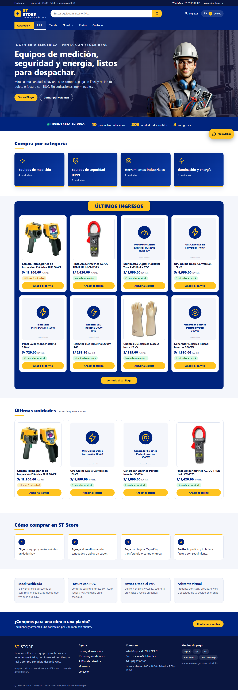
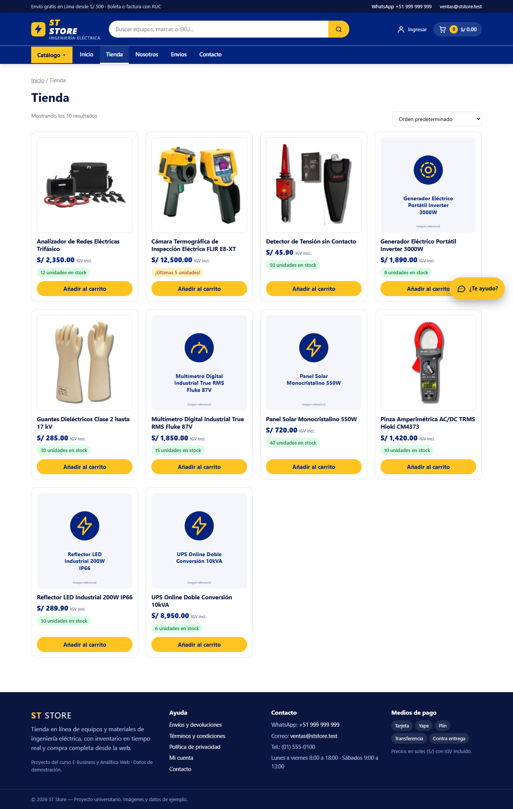
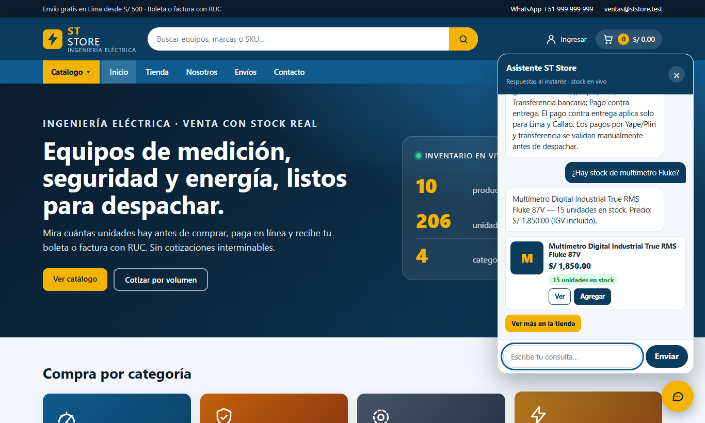
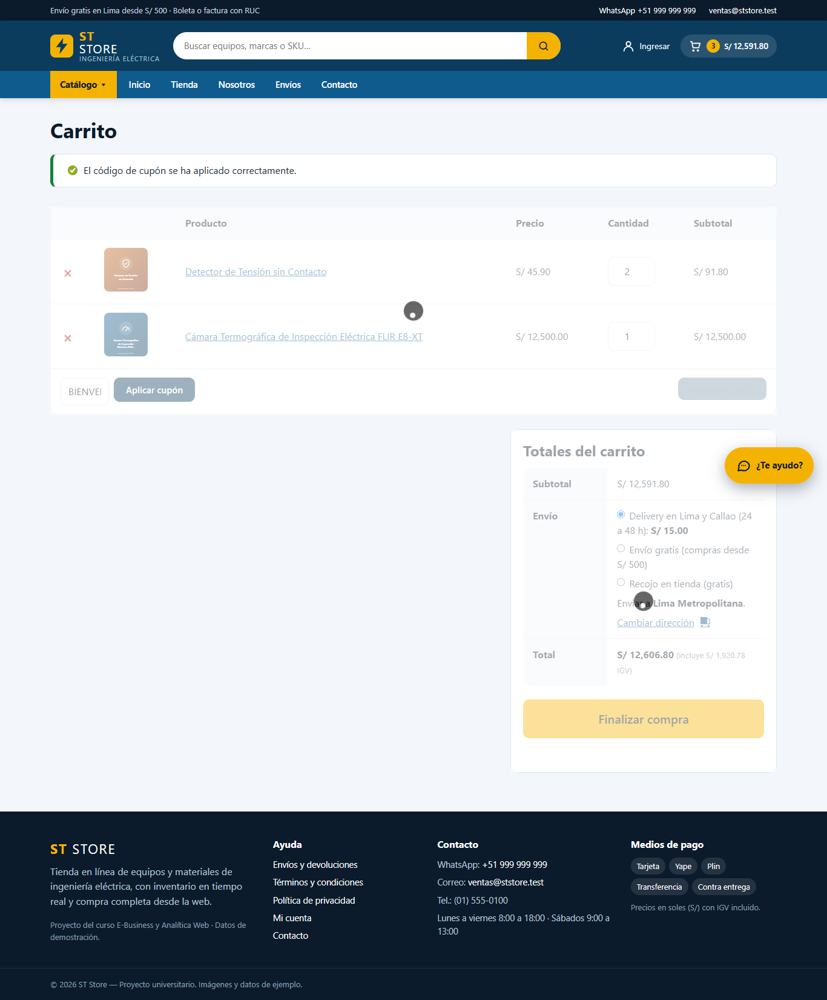
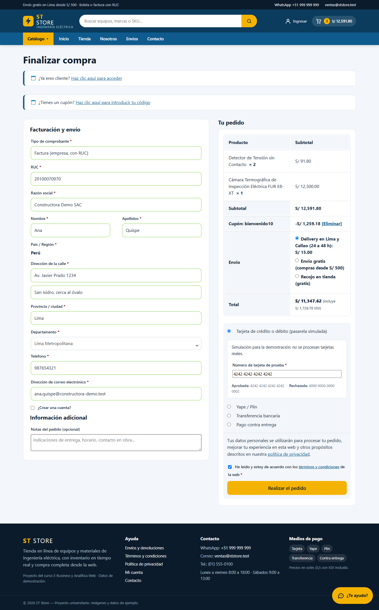
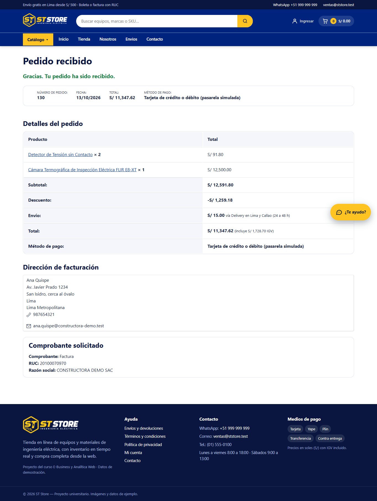
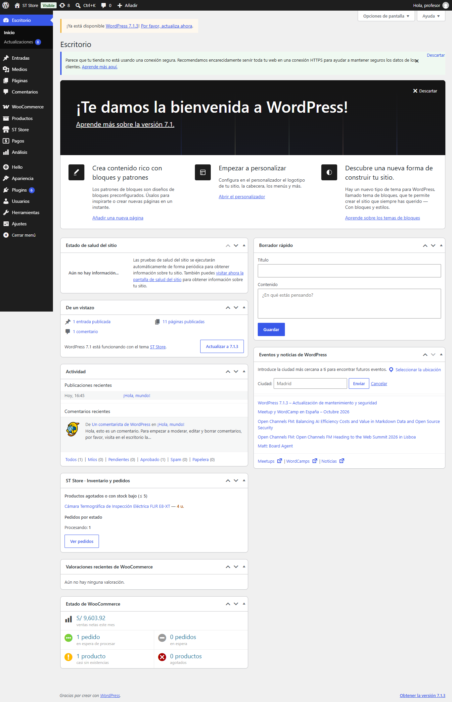

# ST Store · e-commerce de ingeniería eléctrica con stock real

Proyecto del curso **E-Business y Analítica Web** (UPN). Tienda en línea hecha en **WordPress + WooCommerce** que vende
equipos y materiales de ingeniería eléctrica (medición, seguridad, herramientas, iluminación y energía) con
**inventario en tiempo real**: el stock se muestra al cliente, se descuenta al confirmar la compra y se repone si el
pedido se cancela.

> Es un proyecto clonable: incluye el núcleo de WordPress, el tema, los plugins y los datos de la demo.
> Para verlo en tu PC sigue **[INSTALL.md](INSTALL.md)** (clonar, crear una base de datos vacía y abrir la URL; no hay que importar nada).

## Estado: Entrega 2 (≈ 80 %)

| Área | Estado |
|---|---|
| Landing y catálogo con stock por producto | ✅ |
| Carrito, cupones y cálculo de envío (Lima / provincias / recojo) | ✅ |
| Checkout con **boleta (DNI) o factura (RUC)**, IGV incluido | ✅ |
| Pagos: tarjeta (pasarela simulada), Yape/Plin, transferencia, contra entrega | ✅ (pasarela real: pendiente) |
| Pedido → *En preparación → Enviado (con seguimiento) → Entregado*, correos al cliente | ✅ |
| Panel de administración: pedidos, inventario, correos simulados | ✅ |
| **Chatbot** con stock, precios, envíos, pagos y estado de pedido | ✅ |
| 16 productos (4 por integrante) | 🔄 en curso — ver [productos por integrante](sample-data/productos-por-integrante/README.md) |
| Analítica web (Google Analytics 4 / eventos de e-commerce) | 🔲 pendiente |
| Pasarela de pago real y comprobante electrónico SUNAT | 🔲 fuera de alcance del curso |

Detalle por entrega: [`docs/entregas.md`](docs/entregas.md) · Flujo de compra vs. diagrama UML: [`docs/flujo-de-compra.md`](docs/flujo-de-compra.md) · Chatbot: [`docs/chatbot.md`](docs/chatbot.md)

## Así se ve



| Catálogo con stock | Chatbot |
|---|---|
|  |  |

| Carrito con cupón | Checkout con factura (RUC) |
|---|---|
|  |  |

| Pedido recibido | Panel: inventario y pedidos |
|---|---|
|  |  |

Más capturas (ficha de producto, pedidos, correos simulados, versión móvil) en [`docs/capturas/entrega-2/`](docs/capturas/entrega-2/).

## Equipo

| Integrante | Aporte |
|---|---|
| Joaquín Alberto Villalobos Oviedo | Desarrollo del sitio (tema, flujo de compra, chatbot), repositorio en GitHub; catálogo de medición, seguridad y herramientas |
| Mayquel Carlos Bernaola Benites | Catálogo de equipos de medición y fichas técnicas |
| Alex Agustino Lahuanampa Aparco | Catálogo de protección eléctrica y herramientas; precios de referencia |
| Jordy Irving Solorzano Castro | Catálogo de iluminación y energía; control de calidad del catálogo |

Cada integrante sube **su propio archivo CSV** de productos con sus propios commits (pestaña *Commits* o *Contributors* de GitHub).

## Cómo está organizado

```text
├── INSTALL.md                         ← cómo levantarlo en localhost
├── wp-admin/, wp-includes/, wp-*.php  ← núcleo de WordPress (oficial, GPL)
├── wp-content/
│   ├── mu-plugins/stenergy-store-*    ← núcleo de la tienda: configuración Perú, catálogo desde CSV, checkout RUC/DNI, pagos, estados
│   ├── plugins/stenergy-chatbot/      ← chatbot propio
│   ├── plugins/woocommerce/ …         ← plugins gratuitos
│   ├── themes/stenergy-store/         ← tema hijo (diseño propio)
│   └── languages/                     ← traducción al español
├── sample-data/productos-por-integrante/  ← un CSV por integrante (fuente del catálogo)
├── docs/                              ← entregas, diagramas, capturas, chatbot, dependencias
└── tools/                             ← prueba automática del flujo de compra y generador de capturas
```

## Qué NO va en este repositorio

- **Elementor Pro** y cualquier plugin de pago (licencia no redistribuible). La Entrega 1 se hizo con Elementor; ver [`docs/entrega-1`](docs/entrega-1/README.md).
- **Datos reales de una empresa** (proveedores, precios de alquiler, clientes, pedidos). Todo el catálogo es de ejemplo, de **venta** con stock.
- **`wp-config.php`** ni credenciales. Cada quien genera el suyo con el asistente de WordPress.
