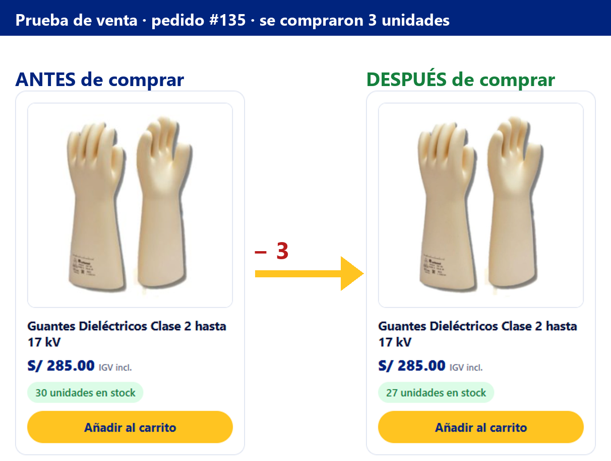

# Prueba de venta completa (con stock en vivo)

Compra real de punta a punta en la tienda, con capturas de cada paso. Producto: **Guantes Dieléctricos Clase 2 hasta 17 kV**
(SKU `JOA-004`), 3 unidades, cupón `BIENVENIDO10`, boleta con DNI y pago con tarjeta de prueba.
Resultado: el stock pasó de **30 a 27 unidades** y se generó el **pedido #135**.



## Pasos para repetirla en tu localhost

| # | Qué hacer | Qué debes ver | Captura |
|---|---|---|---|
| 1 | Abre `http://localhost/stenergy-store/tienda/` y busca la tarjeta de los guantes | "**30 unidades en stock**" | [01](capturas/prueba-de-venta/01-catalogo-stock-antes.png) |
| 2 | Entra a la ficha del producto | Precio S/ 285.00 (IGV incluido) y "30 unidades en stock" | [02](capturas/prueba-de-venta/02-ficha-stock-antes.png) |
| 3 | Pon cantidad **3** y pulsa *Añadir al carrito* | Aviso de producto agregado; el contador del carrito (arriba a la derecha) pasa a 3 y muestra el subtotal | [03](capturas/prueba-de-venta/03-agregado-al-carrito.png) |
| 4 | Ve a *Carrito*, escribe el cupón `BIENVENIDO10` y aplícalo | Descuento del 10 %, envío y total con IGV | [04](capturas/prueba-de-venta/04-carrito-con-cupon.png) |
| 5 | *Finalizar compra*: comprobante **Boleta**, DNI `45871236`, nombre, dirección en Lima, teléfono y correo | El costo de envío se calcula solo; si el DNI no tiene 8 dígitos no deja continuar | [05](capturas/prueba-de-venta/05-checkout-datos.png) |
| 6 | Medio de pago **Tarjeta** `4242 4242 4242 4242` (pasarela simulada), acepta los términos y pulsa *Realizar el pedido* | Pago aprobado (con `4000 0000 0000 0002` sale "rechazada" y no se descuenta stock) | [06](capturas/prueba-de-venta/06-checkout-pago.png) |
| 7 | Pantalla de pedido recibido | N.º de pedido, comprobante (boleta + DNI), detalle y total pagado | [07](capturas/prueba-de-venta/07-pedido-recibido.png) |
| 8 | Vuelve a la ficha del producto | "**27 unidades en stock**" (bajó 3) | [08](capturas/prueba-de-venta/08-ficha-stock-despues.png) |
| 9 | Vuelve al catálogo | La tarjeta también muestra 27 | [09](capturas/prueba-de-venta/09-catalogo-stock-despues.png) |
| 10 | Abre el chat y pregunta *¿Cuántas unidades hay de guantes dieléctricos?* | El asistente responde con el stock actual (27) y botones *Ver* / *Agregar* | [10](capturas/prueba-de-venta/10-chatbot-stock-actualizado.png) |

### Lo que ve el administrador (panel → `http://localhost/stenergy-store/wp-admin/`)

| # | Dónde | Qué debes ver | Captura |
|---|---|---|---|
| 11 | WooCommerce → Pedidos | El pedido #135 en estado *Procesando* | [11](capturas/prueba-de-venta/11-admin-lista-de-pedidos.png) |
| 12 | Abre el pedido #135 | Datos del cliente, comprobante (Boleta, DNI), cupón, IGV, envío y la **nota automática "Niveles de inventario reducidos: Guantes Dieléctricos (30→27)"** | [12](capturas/prueba-de-venta/12-admin-pedido-detalle.png) |
| 13 | Productos | La columna *Inventario* del producto muestra 27 | [13](capturas/prueba-de-venta/13-admin-producto-stock.png) |
| 14 | ST Store → Correos simulados | El correo de confirmación al cliente (no se envía de verdad en localhost) | [14](capturas/prueba-de-venta/14-admin-correo-confirmacion.png) |

Para seguir el pedido: cámbialo a *En preparación* y luego a *Enviado* (con courier y n.º de seguimiento); el cliente recibe
el correo con el seguimiento. Detalle en [`flujo-de-compra.md`](flujo-de-compra.md).

## Volver a empezar (restaurar el stock)

En el panel: **ST Store → Estado → Re-sincronizar catálogo desde los CSV** deja el stock como en los archivos
(también vuelve a 30 los guantes). Si cancelas el pedido #135, WooCommerce repone las 3 unidades solo.

## Repetir la prueba automáticamente

```bash
npm i --no-save playwright-core
node tools/prueba-de-venta.js http://localhost/stenergy-store
```

Con las capturas del panel: agrega `STS_ADMIN_USER=usuario STS_ADMIN_PASS=clave` antes del comando.
Cambiar de producto o cantidad: `STS_PRODUCTO="fluke" STS_CANTIDAD=2`. Las capturas se guardan en
`docs/capturas/prueba-de-venta/`. Para las 28 verificaciones automáticas: [`tools/README.md`](../tools/README.md).
